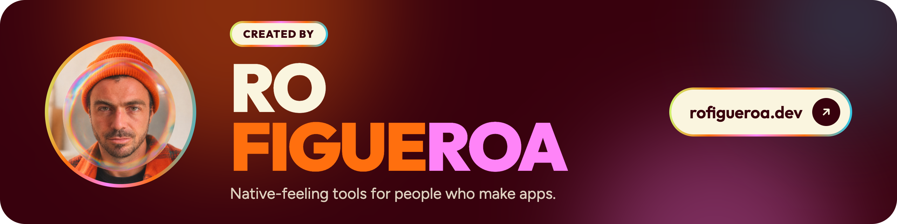

<p align="center">
  <a href="https://cal.com/rodrigo-figueroa-vmbwee/30min"></a>
</p>
<p align="center">
  <a href="https://rofigueroa.dev"></a>
</p>

# StorySeam

A browser studio for building the Whistlewood episode end-to-end: write the
screenplay, break it into shots, generate audio/video via Higgsfield, assemble
cuts, and drive the whole pipeline from a built-in chat agent. Multi-project,
with per-user accounts.

The header tabs are the workflow: **Script**, **Shot list**, **Episode**,
**Complete cuts**, **Editor**, **Library**, **Sound studio** — plus a project
switcher and the **Studio agent** chat panel on the right.

The **Radio** tab is the audio-only pass (every line voiced), and **Build
animatic** there joins it to the storyboard: each shot's still on a picture
track, timed to the voiced dialogue, so the episode can be watched before any
video is rendered. Shots with no still yet become labelled *slates* you can fill
by right-clicking the timeline. Design record: [`docs/prd-animatic.md`](docs/prd-animatic.md).

Each tab is a real **URL route** (`/script`, `/episode`, …) — React Router v7 in
data mode, with per-route lazy loading + loader-driven SWR caching. Architecture,
the revalidation rule, and gotchas are in [`docs/routing.md`](docs/routing.md).

The pipeline is also reachable from **outside** the app: the Worker serves an
**MCP server** at `POST /api/mcp`, so Claude Desktop / Claude Code / Cursor can
read the world, script, shot list, episode and cuts (and write the shot list)
from an editor. Tools, the `MCP_TOKEN` bearer auth, and client setup are in
[`docs/mcp.md`](docs/mcp.md).

## Architecture

Three processes, no Express server (the old Express/Render backend was retired):

- **Vite + React front-end** (`src/`, port **3333**). Renders the studio and
  proxies all data/media paths to the Worker (see `vite.config.js`). `/eve` is
  proxied to the agent so the chat is same-origin (no CORS).
- **Cloudflare Worker** (`worker/`, name `shot-studio-uploads`) — the backend.
  `src/index.js` + `src/routes/*` serve the JSON API and stream media; auth is
  Better Auth (`src/auth.js`). Storage: **D1** (`DB`) for project/script/shot
  data, **R2** (`BUCKET`) for media bytes, **KV** (`AUTH_KV`) for sessions. A
  Durable Object (`ProjectEvents`) fans out live-update SSE so edits sync across
  tabs. It also serves the built `dist/` as static `ASSETS` in production.
  Deployed at `https://storyseam.app`.
- **Studio agent** (`flue-agent/`) — a [flue](https://flueframework.com) chat
  agent running as its **own Cloudflare Worker** (`shot-studio-flue-v2`; agents are
  Durable Objects), model `anthropic/claude-sonnet-5` (Opus 4.6 / Fable 5 via the
  in-chat picker) routed through Cloudflare AI Gateway. It drives the pipeline
  through typed tools (`flue-agent/src/tools/*.ts`) and render skills
  (`flue-agent/src/skills/*`), calling the Higgsfield MCP to render audio/video,
  with a Daytona sandbox for bash/skill execution. The main Worker proxies
  `/eve/*` to it (injecting the session user id + an HMAC identity), so the chat
  stays same-origin. Deploy/run: `flue-agent/DEPLOY.md`.

By default the front-end talks to the **deployed** Worker, so `npm run dev` alone
gives a working app — no local backend needed.

## Running it

From this `shot-studio/` directory (`npm install` already done):

```bash
npm run dev        # front-end only on http://localhost:3333 → deployed Worker backend
```

To run the chat agent too (needs **Node ≥ 22.19**; the UI/Worker run on any Node),
the full local chain is Vite → main Worker → flue Worker:

```bash
npm run stack   # flue agent + Worker (:8787) + Vite (:3333) together
```

`npm run flue:dev` is a Vite dev server (flue 2 has no `flue dev`); it prints its
local URL — set `FLUE_V2_ORIGIN` to it in `worker/.dev.vars` so the Worker's
`/eve/*` proxy reaches the local flue agent. Or start pieces individually:

```bash
npm run dev            # UI on :3333
npm run flue:dev       # flue agent (its own wrangler dev; note the printed URL)
npm run worker:dev     # local Worker on :8787 (proxies /eve/* to FLUE_ORIGIN)
```

flue agent secrets live in `flue-agent/.dev.vars` (copy `.dev.vars.example`):
`ANTHROPIC_API_KEY`, `FLUE_PROXY_SECRET` (must match the Worker's), `SHOT_STUDIO_API`,
and optionally `DAYTONA_API_KEY`, `HIGGSFIELD_MCP_URL`, `ANTHROPIC_GATEWAY_URL`.

To point the UI at a **local** Worker instead of the deployed one, set `WORKER`:

```bash
npm run worker:dev                          # terminal 1 → :8787
WORKER=http://localhost:8787 npm run dev    # terminal 2
```

### Production / deploy

```bash
npm run worker:deploy   # builds dist/ then `wrangler deploy` (Worker serves dist/ as ASSETS)
```

## Testing

```bash
npm test                # Vitest: SPA + Worker + flue agent logic (offline, deterministic)
npm run test:coverage   # + a v8 coverage report in coverage/
npm run test:e2e        # Playwright smoke test of the app shell
npm run test:evals      # agent behaviour evals — needs FLUE_BASE_URL (see evals/README.md)
```

One Vitest config, three projects (`test/web`, `test/worker`, `test/flue`). See
**`TESTING.md`** for the full layout, the per-feature coverage map, and the fakes.

## Credentials

flue agent secrets (`flue-agent/.dev.vars` locally, `wrangler secret` in prod):

- `ANTHROPIC_API_KEY` — **required** for the chat to reply (routed through
  Cloudflare AI Gateway when `ANTHROPIC_GATEWAY_URL` is set, else direct).
- `FLUE_PROXY_SECRET` — shared HMAC secret with the main Worker; must match on
  both sides (falls back to the Worker's `EVE_PROXY_SECRET`).
- `DAYTONA_API_KEY` — sandbox for bash/skill execution (optional; falls back to
  an in-memory sandbox).
- `HIGGSFIELD_MCP_URL` — the generation MCP; the per-user token is bridged from
  the Worker (`/api/agent/higgsfield-token`). Without it the pipeline management
  (script, shots, cuts, library) still works, but no live rendering.

Main-Worker secrets (R2 keys, Better Auth, D1, `FLUE_PROXY_SECRET`, `FLUE_ORIGIN`)
live in `worker/wrangler.jsonc` vars and `wrangler secret`.

## API (proxied paths → Worker)

`vite.config.js` proxies these to the Worker (routes in `worker/src/routes/`):

- `/api` — JSON API: `projects`, `script`, `shotlist`, `episode`, `cuts`,
  `library`, `sounds`, `timeline`, `render`, `auth`.
- `/api/script/events`, `/api/timeline/events` — live-update **SSE** streams
  (no proxy buffering) backed by the `ProjectEvents` Durable Object.
- `/media`, `/multishot-media`, `/sound-media`, `/refs`, `/asset`, `/final`,
  `/gen`, `/files` — media served from R2.
- `/eve` — the flue Studio agent (proxied by the Worker to `shot-studio-flue-v2`,
  or to the frozen flue-1 `shot-studio-flue` for a chat created before the
  migration, injecting the session user id + HMAC identity).

## UI stack

Tailwind CSS v4 + shadcn/ui (New York, zinc base, emerald accent), Vite alias
`@/` → `src/`. See `CLAUDE.md` for component conventions (shadcn primitives,
lucide-react icons only, shared helpers in `src/components/shared.jsx`; each tab
lives in `src/routes/`).
